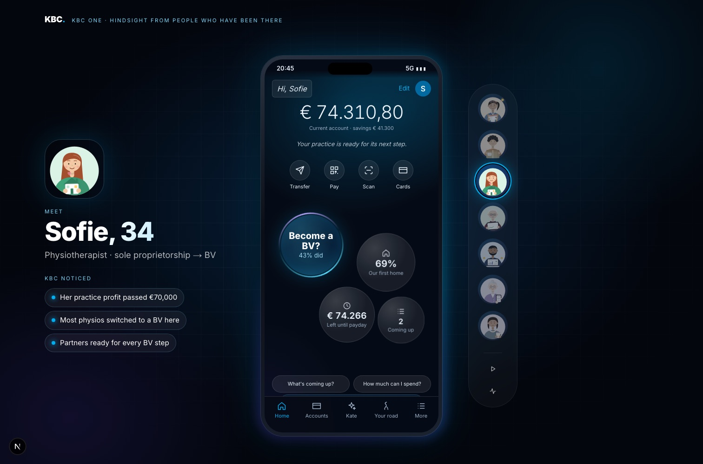
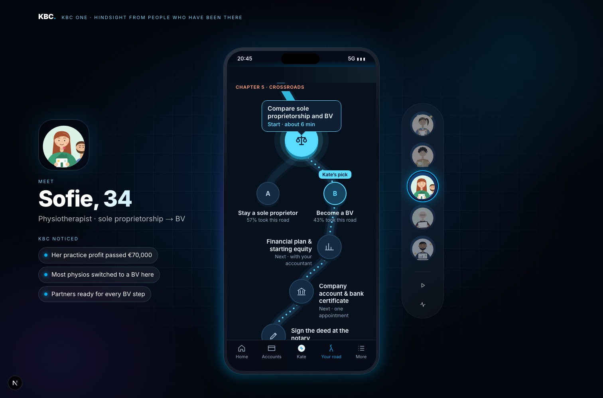
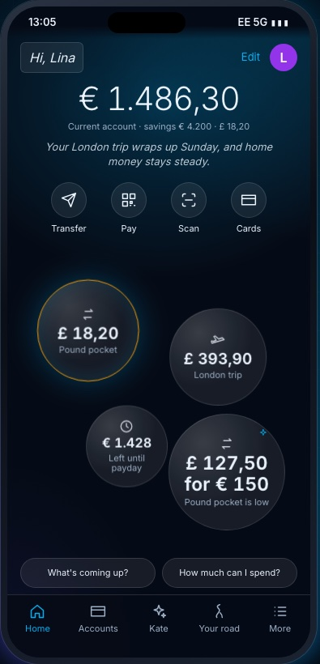
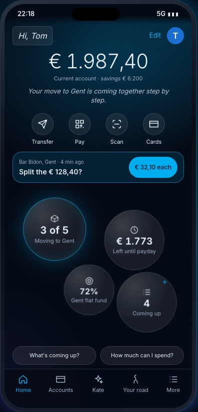
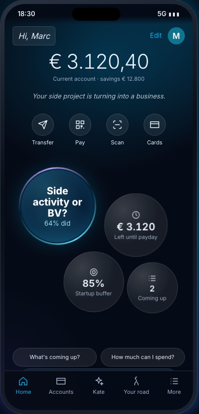
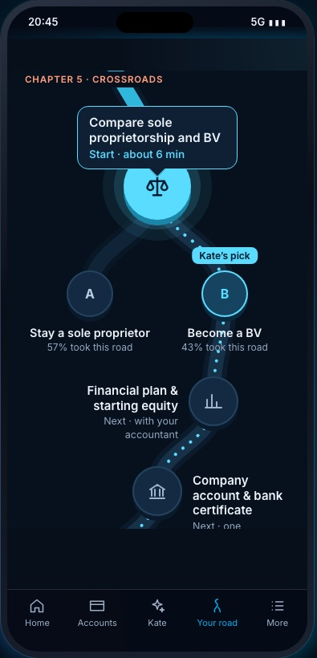
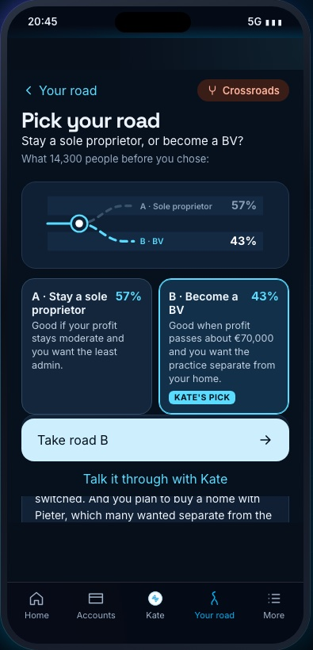
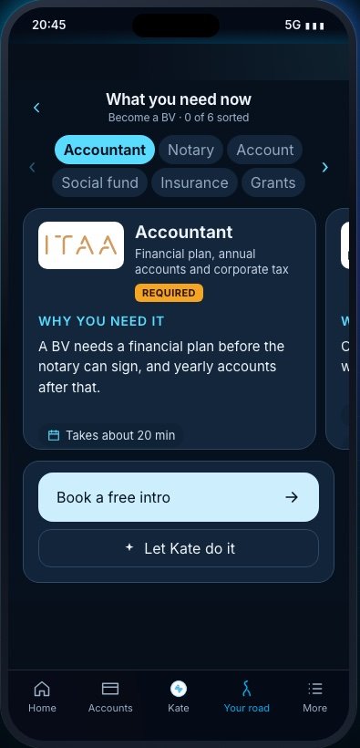
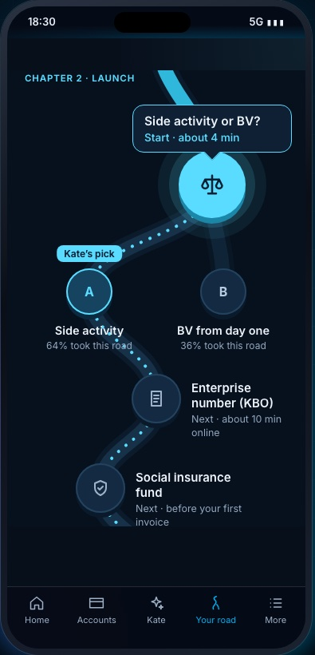

[**Try the live demo →**](https://smashvision-superiorswarm-app-dwj49.ondigitalocean.app/?p=lina)

# KBC One: one step ahead

**Our entry for the KBC challenge at the Tectonic Hackathon:** a proactive banking app that solves the problem before it arrives, because 2.3 million people already walked your road.

Built by **Emma van Doren** ([SmashVision](https://smashvision.ai)) and **Thomas Vrolix** ([SuperiorSwarm](https://superiorswarm.com)).

<table>
  <tr>
    <td width="50%"></td>
    <td width="50%"></td>
  </tr>
  <tr>
    <td><sub><b>Home:</b> what matters now comes to the front. Sofie's home leads with "Become a BV? 43% did".</sub></td>
    <td><sub><b>Your road:</b> one tap later she is at the crossroads, with what earlier customers chose and Kate's pick.</sub></td>
  </tr>
</table>

<sub>The demo stage: pick a customer on the right, see what KBC noticed on the left, and watch the phone in the middle.</sub>

---

## The problem: a bank app nobody fully finds

Who has used every feature in the KBC app? Nobody. The app can do almost everything, but hundreds of features sit behind menus. Customers only go looking once the problem has already hit them: the tax bill, the regularisation letter, the deposit for a new flat, a card that doesn't work abroad.

**Banking apps are reactive. We built one that is proactive.**

## Our answer, in 30 seconds

- **A home screen that knows you.** Kate looks at your transactions, income, expenses and life stage, and only what you need right now comes to the front. Everything else steps back.
- **2.3 million people walked your road before you.** The anonymous journeys of earlier customers become *roads*: moving house, a first home, going freelance, starting a company. You are never the first.
- **Help for businesses before the admin headache.** From sole proprietorship (*eenmanszaak*) to BV to the first employee: the road shows each step, what others chose and who helps.
- **A trusted ecosystem.** At every step KBC offers partners and discounts at the moment of need. Customers save time and money, partners get warm clients, and KBC earns partnership income and keeps customers for the long run.
- **It gets smarter every day.** Kate conversations show which questions come up and when, so the next customer gets the answer before asking.

---

## 1. A home screen that knows you

Every customer gets a different home. Balance, Transfer, Pay, Scan and Cards never move; the bubbles below them are chosen, sized and ordered for this customer, right now. When something new pops up on the home screen, you know it matters.

<table>
  <tr>
    <td align="center" width="33%"><br><b>Lina, 31 · weekend in London</b><br><sub>Card payments in pounds → <b>pound pocket and trip spending up front</b>, a top-up before it runs out</sub></td>
    <td align="center" width="33%"><br><b>Tom, 29 · moving to Gent</b><br><sub>Movers, rent in Gent, a dinner for four → <b>split the bill, the move leads</b></sub></td>
    <td align="center" width="33%"><br><b>Marc, 26 · tech founder</b><br><sub>Just bought a domain name → <b>"Side activity or BV? 64% did"</b></sub></td>
  </tr>
</table>

## 2. Your road: 2.3 million people before you

The **Your road** tab shows where you are and what comes next, based on what earlier customers in the same situation did: the bumps they hit, what helped, and the notes they left. **All roads** lets anyone explore every road (first home, moving house, going freelance, a first child, …) without changing their own.

## 3. Business roads: before the admin headache arrives

KBC knows your job from your transactions. For business customers, Your road becomes a **founder road**: one clear vertical road in seven chapters, from *Spark* to *Exit*.

<table>
  <tr>
    <td align="center" width="25%"><br><sub><b>Sofie's road</b> opens at her current step</sub></td>
    <td align="center" width="25%"><br><sub><b>The crossroads:</b> what 14,300 physios chose</sub></td>
    <td align="center" width="25%"><br><sub><b>What you need now:</b> one card per thing to sort</sub></td>
    <td align="center" width="25%"><br><sub><b>Marc's road</b> starts at Launch</sub></td>
  </tr>
</table>

**Sofie, 34, a physiotherapist, from sole proprietorship to BV.**
- **Already done:** KBC helped her found her sole proprietorship, and her road shows it all checked off. That covers the KBO check and enterprise number, the social security check, RIZIV, the VAT exemption for treatments, insurance, the first regularisation and her own practice room.
- **The signal:** her practice profit just passed about €74,000, which is where most physios before her switched to a BV. Her home shows **Become a BV? 43% did**.
- **The crossroads:** one tap shows both roads with what each group said afterwards (stay a sole proprietor 57%, become a BV 43%), and Kate suggests the best road for her numbers.
- **After the choice:** the road moves on to the BV steps (financial plan, bank certificate, notary deed, UBO register, director's salary). A bar on the road opens **What you need now**: one card per thing to sort (accountant, notary, account, social insurance fund, insurance, grants), each with why you need it, the time it takes, who can do it with their logo and Kate's pick, and what KBC does. Act directly, or let Kate prepare a draft you approve with itsme *(demo)*; the road ticks off the step.

**Marc, 26, a tech founder who just bought a domain name.** KBC spots the signal (a domain at Combell, a developer account) and shows what 18,700 founders did next: start as a side activity or a BV from day one, then the enterprise number, social insurance fund, VAT and a business account, months before the paperwork piles up.

The same view covers other job roads: a lawyer from trainee to own practice, a student entrepreneur, a freelancer moving to a BV, and a business owner hiring a first employee.

## 4. A trusted ecosystem, good for everyone

At every step the road shows **who helps**, on the road and on the *What you need now* cards: business counter, social insurance fund, accountant, notary, lawyer, VAT administration, insurer, social secretariat, RIZIV, the bar, VLAIO, VDAB and KBC itself. It lists the Belgian organisations people on that road used, for example:
- ITAA-registered accountants and notaris.be;
- the social insurance funds Liantis, Acerta, Xerius, Partena Professional and Securex;
- UNIZO, VLAIO and Start it @KBC.

It also shows what others chose, for example *54% used the notary their accountant works with*. KBC offers partners and discounts right at the moment of need:

| | What they get |
| --- | --- |
| **Customers** | Time, money and a lot of headaches saved |
| **Partners** | Warm, ready-to-go clients at the exact moment they need help |
| **KBC** | Partnership income, and customers who stay for the long run |

## 5. It gets smarter every day

- **Kate conversations teach the system.** Every question shows which steps come up and when, so the next customer on the road gets the answer before asking. Kate answers from the customer's own facts, and from what the people on the same road did.
- **Kate coins** *(concept, next step)*: customers who share their experience, such as *"I wish I'd known this in month 3"*, get rewarded. Knowledge sharing becomes a loop of trust.
- **No tokens burned on every screen** *(next step)*: a small, cheap open-source classifier, **Laya**, ranks what matters on the home screen, so it stays fast and affordable at millions of customers. Today the demo composes the home with Claude, or with built-in rules when the AI is off. A Laya ranking prototype exists on the `laya` branch.

---

## The demo in six taps

Open the [live demo](https://smashvision-superiorswarm-app-dwj49.ondigitalocean.app/?p=lina) (or `http://localhost:3700/?p=lina` locally) and reload once for a clean run.

1. **Lina** (first on the rail): the London trip, with the pound pocket up front.
2. Tap **Tom**: split the dinner bill, and the move to Gent leads.
3. Tap **Sofie**, then the **Become a BV?** bubble: her founder road opens at the current step.
4. Tap the glowing step to open the **crossroads**, with what 14,300 physios chose and Kate's pick.
5. Tap **Take road B**, then the bar on the road: **What you need now** shows the partners for a BV, and Kate can prepare each step for you.
6. Tap **Marc**, then **Side activity or BV?**: the tech founder's road, from domain name to company.

Road progress lives in memory, so a reload starts the demo again.

---

## What's real and what's mocked

| Working in the prototype | Mocked for the demo |
| --- | --- |
| Personal home with bubbles per customer, composed by Claude or by built-in rules | All customers, transactions and practice figures are synthetic |
| Your road, All roads and the 2D road views | The 2.3 million-customer crowd and every percentage are synthetic demo data |
| Founder roads for 6 jobs, with chapters, crossroads, *What you need now* cards and Kate's drafts | Partner offers are example offers, the named organisations are where people go (not KBC partners), and itsme approval is simulated |
| Kate on the Anthropic API (`claude-opus-5-5`), with grounding checks and a rules fallback | Payments, bookings and reminders are demo records, not real instructions |
| Typecheck, build and 232 automated tests in CI | Kate coins and the Laya home ranking are next steps |

The Belgian rules on the business roads are real but simplified, for example the €25,000 VAT exemption limit and the €45,000 director's salary for the reduced corporate tax rate. They are not legal or tax advice, and amounts change yearly.

---

## Run it

The pitch app lives in [`kbc-one-v10/`](kbc-one-v10/). Use Node.js 24 and Bun.

```sh
cd kbc-one-v10
bun install --frozen-lockfile
bun run dev
# http://localhost:3700/?p=lina
```

| Environment variable | Effect |
| --- | --- |
| `ANTHROPIC_API_KEY` | Kate and the home composer use the Anthropic API (needed on servers) |
| *(not set)* | Locally, the signed-in `claude` CLI is used instead |
| `KBC_AI=off` | Built-in rules only: stable for timed rehearsals |
| `KBC_KATE_MODEL`, `KBC_COMPOSE_MODEL` | Override the model (`opus`, `sonnet`, `haiku` or a full model ID) |

**Deploy:** a Node web service with source directory `kbc-one-v10`, build `bun run build`, run `bun run start`, HTTP port **3700**, **one** container (demo state is kept on the server's disk), and `ANTHROPIC_API_KEY` as an encrypted environment variable.

**Checks:** inside `kbc-one-v10/`, run `bun run typecheck`, `bun run test` and `bun run build`. CI runs them on every pull request.

## Repository

| Folder | What it is |
| --- | --- |
| [`kbc-one-v10/`](kbc-one-v10/) | **KBC One**, the pitch app: home, Kate, Your road and the founder roads ([app README](kbc-one-v10/README.md)) |
| `src/` | Our first prototype, *One KBC. Your version.*: the adaptive home with explainable needs and the building-block gallery ([its README](docs/one-kbc-prototype.md), [live](https://smashvision-superiorswarm-nyax3.ondigitalocean.app)) |
| `docs/` | Screenshots, personas, building blocks and the developer guide for the first prototype |

---

**Built with** Next.js, React, TypeScript, Motion, Bun and Claude (Anthropic).
