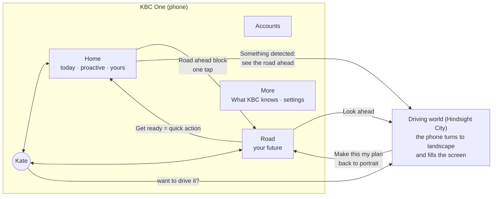

# 02 · Product: one app for today and for your future

## The promise, and which build delivers it

| KBC One | What it means in the app | Comes from |
|---|---|---|
| **1 person, 1 app** | Your home is composed for you every time you open it, you reshape it by talking to Kate, and you can make your own unique theme ("I like a pink, girly style"). Your road is yours too: your household, your goals, your pace, in your theme. | Kate: three-zone home, 4 styles, generated themes, trackers. Hindsight: your own household replay. |
| **1 click away** | Whatever Kate notices, now or on the road ahead, is prepared as one tap: amount, account and payee filled in. | Kate: quick actions, open-intent, safety levels. Hindsight: tips → pots. |
| **1 perfect road to your future** | One route that merges the Everyday Road and your life road, with destinations, the crowd's hindsight and a place to plan big decisions. | Hindsight: roads, Everyday Road, destinations, City. |

**About "perfect".** Inside the app we never claim to know someone's future; that is the core of Hindsight and of our "no big brother" rule. "Perfect" means *the best route for you, chosen by you, using what the people before you lived*. App copy says "people at your point", "last year you paid", "drivers who started like you". It never says "you will".

## Four horizons, one app

| Horizon | The customer's question | Where it lives | Built from |
|---|---|---|---|
| **Now** (minutes to days) | Why did I open the app? Is something wrong? | Home: open-intent, protection, Ready for you | Kate |
| **This month** (next 30 days) | Am I OK until payday? | Home: Until payday (with the lowest point), Buffer | Merged |
| **This year** | What does the money year bring? | Home: Coming up, Road ahead. Road tab: the Everyday lane | Hindsight's Everyday Road |
| **Life** (years) | Where am I heading? What did people like me do? | Road tab, Destinations, Hindsight City | Hindsight |

The Home covers the first two and peeks at the third. The Road and the driving world cover the last two and link back to the first. Kate covers all four.

## When people use it

This answers the v3 feedback ("useful only at particular moments").

- **Every open** → Home. Short, proactive, mostly one tap.
- **When something happens** → the open-intent card or a protection block (dinner just paid, double debit, card declined abroad).
- **Once a month** → **Salary day**. The month closes, the recap shows what you did (Kate's side) and how the road moved (Hindsight's side), and the home recomposes for the new month.
- **When looking further ahead, or when KBC notices something that changes the road** → the driving world in the landscape phone: at a life moment, before a big decision, a bump coming up unprepared, or the yearly look in December and January.

## App map

Bottom navigation: **Home · Accounts · Kate · Road · More**. Payments stay in the core bar (Transfer, Pay, Scan, Cards), so we don't lose a bank basic by adding Road.

## Home (short term)

The Kate home stays as it is, and stays **tailored to the person**: Claude composes it on every open from what is happening now (style, blocks, sizes, the one open-intent, up to three quick actions), and the customer can take over at any moment: their own blocks, their own trackers, and **their own unique theme** made with Kate (colours, font, corners, motif; contrast fixed by code). Core bar, headline, open-intent card, Ready for you, My blocks / For you and the Kate dock are unchanged. What changes:

**New and reworked blocks** (all render in Calm, Cards, Dense and Large & simple):

| Block | Status | S / M / L | Large & simple sentence | Data |
|---|---|---|---|---|
| `road_ahead` | new | next stop · next 3 stops with readiness · 12-month mini lane + **Look ahead** (opens the driving world) | "Next on your road: your first energy bill in a new home, in about 6 weeks." + one big button | `life.upcoming` |
| `buffer` | new | months of buffer · + the crowd's median at your point | "Your savings cover about 2 months of bills." | `life.fuel`, `fuelCrowd()` (gated) |
| `cover_check` | new | cover worth a look (info only) | "Your family liability cover is worth a check." | `life.def.cover` |
| `left_until_payday` | reworked | + lowest point and its date | unchanged | `life.next30`, `life.lowest` |
| `upcoming_payments` | reworked | same look, now from the replay | unchanged | `life.next30` |
| `savings_goal`, `home_buying` | reworked | + arrival date, + crowd odds, + "Automate" action | "At € 150 a month you arrive around August 2030." | `life.goals`, `goalCrowd()` |
| `coming_up` | reworked | Everyday Road stops + your own dates | unchanged | `life.upcoming` (everyday lane) + calendar |

**Rules on the Home**

- At most **one road item** in Ready for you, and road items never sit above protection or the open-intent card.
- A road item is "now" only when a bump is within about 6 weeks and less than 50% prepared; otherwise "later". (`todayPick()` today looks 90 days ahead; on the Home we tighten that so the road doesn't crowd out the moment.)
- On **salary day** the open-intent slot shows "Close October" → recap → the usual savings move.
- A **look-ahead card** ("See the road ahead") takes the open-intent slot only when nothing is happening right now (no split, no decline, no salary day); otherwise it waits in For you. One per day at most, and "Not now" mutes it for that stop.
- The customer's own blocks never move (unchanged Kate rule). `road_ahead` can be pinned like any block.
- On a **care road** before opt-in: no suggestions, no products, no road actions; the advisor block comes first; protection still shows.

## Road (long term)

One tab, in this order:

1. **Where you are**: the road pointer ("First home · month 3 of 24 · 41,212 drove it"; the crowd count goes through the gate) and the Everyday Road month. The car lives here: fuel (buffer), boot (pots and goals), tyres (cover).
2. **The next 12 months**: both lanes merged (Hindsight `RouteView`). Each stop: when, typical amount (crowd) or your last-year amount, readiness, **Get ready** (the same quick action as on Home).
3. **Destinations**: goals with pace slider, ETA, crowd odds, what made the difference, **Automate** (one tap).
4. **Likely next exits**: where drivers went next, with **Test-drive**.
5. **Behind you**: passport (finished roads), and who at KBC looked at your road.
6. **Look ahead** (also the main button at the top of the tab): opens the driving world in the landscape phone.
7. **Pass it on**: leave a line for the drivers behind you (moderated twice).

The Road tab wears the customer's style and theme. In Large & simple it becomes a plain list: the next three things and your goals, no gauge, no lanes.

## Looking ahead: the driving world on the phone

The Home handles today. As soon as the customer **looks further ahead**, or KBC **notices something that changes the road**, the app offers the driving world (Hindsight City). It always opens on the customer's tap, never by itself.

**Looking further ahead**

- **Look ahead**: the main button at the top of the Road tab.
- **Drive it** on the large Road ahead block, and "See the way there" on a destination.
- Kate: after "what's ahead for me?" or "what if we bought now?" she offers "Want to drive it?".

**Something detected** (a card in the open-intent slot or in For you):

- a life event the customer confirmed: "You told us you're moving on 1 Nov. See the road ahead";
- a crossroads within about 6 months (Karim: sole trader or company);
- a bump within about 6 weeks that isn't prepared yet;
- a road the customer is about to enter (Sofie used the mortgage simulator three times: "Drive First home before you buy").

Weak signals stay a question first ("Planning a move?"); the drive is offered only after "Yes". Care roads never get the game; they get the calm Road view.

**What it looks like on the stage**

1. The app content fades and a small "turn your phone" hint shows (about 0.3 s).
2. The phone rotates 90° to landscape and grows until it fills about 95% of the screen width, about as big as the City is full screen today. The story and the cast rail fade back (about 0.6 s).
3. The screen is dark, then **turns on**: a thin line of light opens into the picture (about 0.35 s). The City starts at the customer's month on their road, with the stop that triggered it just ahead.
4. Play as in v4: WASD or arrows, E to pull over, M for bird's eye; touch pads on a touch screen. The HUD is laid out for the phone screen it is in.
5. **Back to the app** (a button on the bezel, or Esc): the screen switches off, the phone turns back to portrait and shrinks, and the customer lands where they came from, with any plan they saved.

With reduced motion: no rotation, a crossfade. On a real phone (later, for example a juror's own phone) the same button asks to go full screen and to turn the phone; where the browser allows it, we lock landscape.

**What driving does** (decision D2): looking ahead is a preview. Driving shows how the next months go *with your current preparation* (paved or hit). A crossroads branch is a trial. Nothing changes until **Make this my plan**, which saves the pots, goal paces and the chosen branch. Real time moves only on salary day; the salary-day autopilot drive plays in the landscape phone too. (Hindsight v4 moved your month as you drove.)

Unchanged from v4: test drives of other roads, ghost cars, notes from drivers ahead, passport stamps, care roads without a game layer, the readability rules. Later: your car painted in your theme's accent colour.

### How the game is launched, and for whom

There is **no separate game button on the stage**. The game always starts from a button on the phone, as it would in the real app. In v5 there are three ways in:

1. **A card on the Home** when KBC notices something (**See the road ahead**, or **Test-drive it** for a road you're about to enter).
2. **Look ahead** at the top of the Road tab.
3. **Kate**: ask "What's ahead for me?" and her answer comes with a **Look ahead** card.

As a backup for the demo, the drawer's Director tab has **Look ahead now** for the selected person.

| Person | Gets the game? | What starts it (as built in v5) | Where the drive starts |
|---|---|---|---|
| **Tom** | Yes, in the demo | Card on his Home: "You told us you're moving to Gent on 1 November. See the road ahead.", with a one-tap tip "Set aside €150 for setting up" | His Moving house road, month 0 |
| **Karim** | Yes, in the demo | Card on his Home: "Stay sole trader, or start a company?", in about 4 months | Going freelance, month 20, driving towards the crossroads |
| **Sofie & Pieter** | Yes, as a test drive | Card on their Home: "Drive First home before you buy" (they used the mortgage simulator three times) → **Test-drive it**; also on the Road tab | First home from month 0, as a test drive: it isn't their road yet, so nothing changes |
| **Lina** | Only if she asks | No card (nothing big ahead); **Look ahead** on the Road tab, or Kate | The Everyday Road (the ring) at this month |
| **Margaret** | No | Large & simple: the Road tab shows the next three things and her goals in plain words (D7) | — |
| **Nadia** | No | Care road: no game layer, no cards | — (the calm Road view, a person first) |

On stage: pick the person on the cast rail → tap the card on their Home → the phone turns and the screen lights up → drive → **Back to the app** (or Esc) → **Make this my plan**, **Leave it, go back** or **Keep driving**.

## Kate across both horizons

Kate gets the road in her facts (only gated crowd numbers) and four new proposal types. v5 built `drive` (look ahead on your road, or test-drive the next one); `pot`, `goal` and adding a life road are still to build. Examples:

- "What's coming up for me?" → the next three stops with typical amounts, and the one that isn't prepared yet, with a prepared pot to confirm, and "Want to drive it?".
- "Why is January always so expensive?" → the renewals stop: your amount last year, what people who didn't feel January did.
- "Make my flat fund faster" → a goal proposal: € 200 a month, automated, new arrival date.
- "What if we bought now?" → a test-drive of First home in the City or on the Road tab.
- "We're expecting!" → a confirm card: "Put First child on your road? 28,300 drove it before you." The customer decides. Care roads are never proposed by Kate (see trust rules).

## The eight bridges

These are the reason to combine the two builds instead of showing both.

| # | Bridge | Example |
|---|---|---|
| B1 | **Road → Home**: road tips become one-tap quick actions | Tom: "First energy bill at a new address in about 6 weeks. Set aside € 40 a month?" in Ready for you. |
| B2 | **Home → Road**: what you do today moves the road | The € 40 pot paves the bump, the buffer gauge and the route update; a split request paid back raises the buffer. |
| B3 | **What KBC knows → on-ramps** | "You told us: moving to Gent on 1 Nov" is the on-ramp to the moving road. A weak signal stays a question first (round-one rule: 25–60% → ask). |
| B4 | **One goal = one destination** | Sofie's house fund block and her destination are the same object: change the pace in either place. |
| B5 | **Salary day = the monthly bridge** | One recap: requests paid back, rules that ran, tracker totals (Kate) + money in/out, stops paved or hit, fuel before → after, destinations (Hindsight). Then the home recomposes. |
| B6 | **Kate speaks both horizons** | Same chat for "split this with Lien and Arne" and "what did people like me do before the regularisation?". |
| B7 | **Looking ahead or a detection → the driving world** | Karim's crossroads in four months: sole trader or company. One tap, the phone turns to landscape, he test-drives both branches, then "Make this my plan". |
| B8 | **One trust layer** | Care roads calm the whole app; the crowd gate covers every crowd number, including Kate's; one "What KBC knows" with the road pointer and the access log. |

## Trust rules, merged

| Rule | Kate build today | Hindsight today | KBC One |
|---|---|---|---|
| No prediction | — | Nobody is predicted | Everywhere, including Kate's wording |
| Crowd numbers | — | Gate: k ≥ 500, noise, rounding | Every crowd number on every screen and in Kate's facts goes through the gate; held-back numbers say so |
| Products | Only as the next step of what you're doing; max 1 a week; "Not for me" mutes | Advice ranked by outcome; per-road blocked products | Both. Road tips are never products. A road's `blocked` list also filters Kate's candidates |
| Care | — | No offers, no game, fogged road, a person first | Applies to the whole app: Home, Road, Kate, City |
| Pushes | Protection, things you started, your own reminders | Lock-screen road nudge | Road reminders only when switched on per road; lock screen never shows amounts, names or bill types |
| Inference | Ask before assuming, in the app only | Placement by rules | Life roads from what you told us (or a confirmed question); care roads only by the customer's own choice |
| Explanations | Why sheet, ledger | Behind the glass, access log | One ledger with the road pointer, beliefs and the access log |
| Numbers in AI text | Prompt only | No AI | Code check (port round one's `parseModelReply()`), facts include gated road numbers |

## Words: where the car metaphor lives

- **Home** speaks plain bank language: buffer, savings, coming up. A small road icon marks road items.
- **Road tab and City** use the car: fuel, boot, tyres, bumps, paved.
- **Large & simple** never uses the metaphor.
- Later, customers who love it can pick a "Cockpit" style for the Home (not for the final).

## Switching people on stage: v1's cast rail

We use the stage from round one (v1): the person's story on the left, the phone in the middle, a rail of portraits on the right.

- One round portrait per person on the frosted pill. The active one is in full colour, a little larger, with the azure ring; the others are dimmed. A small badge if one person has two stories.
- The story animates in as in v1: Meet → name and age → role → "KBC noticed" pills one by one → the outcome line. In KBC One the outcome line also names the road ("On the road: Going freelance, month 20").
- Only two tools on the pill, as in v1: play tour and "Inside". Everything else goes into v1's drawer: Inside Kate, Behind the glass, salary day, the month slider, re-arrange, reset, lock screen, the gate overlay.
- While the phone is in landscape, the pill fades back. Picking another person first turns the phone back to portrait.
- Hindsight's road dropdown and the Director's persona list are not used. A person's road is part of the person; other roads are test drives inside the app.

## Cast for the final

| Person | Now (Home) | Road | What it shows |
|---|---|---|---|
| **Tom**, 29 | Paid € 128,40 at Bar Bidon 4 min ago → split | Moving house, month 0 (new road, D4); Everyday Road | B1, B2, B3: today's split and the move's first bumps in one home |
| **Lina**, 31 | London: pound pocket low, eSIM, Noor's pocket money | Everyday Road only; destination "City trips" | Most people have no life road; the Everyday Road still helps |
| **Margaret**, 74 | Luminus debited twice → Get it back | Everyday Road only; passport: Retirement | Large & simple: the road as one sentence and one button |
| **Karim**, 45 | Atelier Vos paid € 1.200 → set 21% aside for VAT | Going freelance, month 20: crossroads at month 24, regularisation at month 30 | B7: a big decision in the City |
| **Sofie** & Pieter, 34 | Mortgage advisor on Thursday | Destination "Our first home" (€ 41.300 of € 60.000); test-drive First home before buying | B4: plan before you enter a road |
| **Nadia**, 47 | Nothing to do today | Losing a parent (care road), fogged | B8: the whole app goes calm |

Hindsight's other road personas stay as the drivers of their roads in the City and the Atlas. Renamed in the copy where they clash: First child "Sofie" → Hanne, Losing your job "Tom" → Dries.

## Demo script (about 6½ minutes)

1. **Tom, now** (1 min): pick Tom on the cast rail. The app opens on "Split the € 128,40?" → one tap. *1 click away.*
2. **Tom, his app** (1 min): "Make me a coffee tracker", "I like a pink style". The Road tab turns pink too. *1 person, 1 app.*
3. **Tom, looking ahead** (1.5 min): a card on his home: "You told us you're moving on 1 Nov. See the road ahead." One tap: the phone turns to landscape, grows, the screen lights up, and he drives towards the first energy bill at the new address. Pull over: what people at his point paid and what helped. "Set aside € 40 a month" → Make this my plan → back to portrait: the bump shows as prepared on Road ahead, the buffer moved.
4. **Salary day** (1 min): close October from the drawer. One recap: the split was paid back, the pot took its first € 40, fuel before → after. The autopilot drive plays in the landscape phone, then the home recomposes for November.
5. **Karim, a big decision** (1.5 min): a card: his crossroads is 4 months ahead. Landscape again: test-drive sole trader and company, see how drivers on each branch were doing a year later. "Make this my plan" → a regularisation pot on his Home. *1 perfect road.*
6. **Margaret and Nadia** (30 s): the same app in Large & simple, and the calm care version (no game, a person first).
7. **Behind the glass** (optional): Kate's validator notes and the crowd gate decisions side by side; the Atlas places 2.3M people in the browser.

## How we position it against the other finalists

- **IF-ELSE Adaptive Home** adapts the layout and has a time slider. KBC One also composes and lets the customer build with Kate, and the future comes from real (synthetic) crowds, not one person's timeline.
- **Doppel** writes a 30-day diary of a digital twin: a prediction. KBC One predicts nobody; it shows what people at your point lived, over years, with privacy by construction.
- **Situation 141 / Life Context / Ahead** are engines and policies. KBC One is the customer experience on top of that kind of engine, with the same safety: attention budget, care, crowd gate.
- **Scale**: the Home is composed per customer (cached, event-triggered); the Road costs one pointer per customer and about 260 shared crowd views in total.
